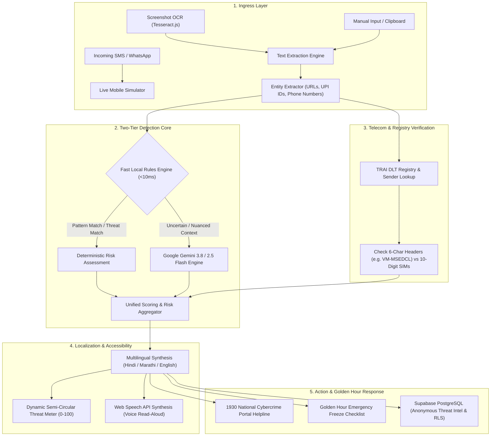

<div align="center">

# 🛡️ ScamShield Bharat (स्कैमशील्ड भारत)
### *Real-Time Vernacular Cyber Fraud Interception & Truecaller-Style AI Defense for Bharat*

[](https://ai.google.dev/)
[](#team--contributors)
[](https://ai.google.dev/)
[](#vernacular-accessibility)
[](https://cybercrime.gov.in)

<p align="center">
  <b>A real-time cybersecurity guardian protecting 1.4 billion citizens across India from financial fraud, utility blackmail, phishing links, and malicious APK downloads.</b>
</p>

[Live Demo](#quick-start) • [Architecture](#system-architecture) • [Key Features](#key-features) • [Threat Scenarios](#curated-threat-scenarios) • [Supabase Schema](#supabase-sql-schema--rls) • [Setup Guide](#installation--setup)

---

</div>

## 📌 Problem Statement: The Cyber Threat in Bharat

India loses over **₹1.2+ Lakh Crore ($14 Billion)** annually to digital financial fraud. With the rapid expansion of digital payments (UPI) and smartphone adoption across Tier-2, Tier-3 cities, and rural areas:

1. **Fear-Driven Blackmail:** Fraudsters prey on basic necessities—threatening immediate power disconnections (*"Electricity bill unpaid, power will be cut tonight"*), bank freezes (*"SBI YONO account suspended"*), or fake police warrants.
2. **The Language Barrier:** Over 85% of citizens communicate in regional languages (Hindi, Marathi, Tamil, etc.), while existing anti-spam tools primarily report technical jargon in English.
3. **The "Golden Hour" Window:** The first **120 minutes** after money is debited are critical to freezing illicit funds on the National Cybercrime Portal (1930). Victims lose money because they do not know what steps to take immediately.
4. **Malicious APK Epidemic:** Fraudsters bypass Google Play Store checks by sending `.apk` links directly via WhatsApp disguised as official apps (e-Challan, PM schemes), silently stealing banking SMS and OTPs.

---

## 💡 The Solution: ScamShield Bharat

**ScamShield Bharat** is an end-to-end, privacy-focused cyber defense system built by **Infinity Coders** that acts as an intelligent Truecaller-style guard on citizen devices:

- **Dual-Engine Analyzer:** Evaluates threats in under **10ms** using deterministic regex patterns, verified TRAI sender headers, and Google Gemini AI for generative explanation.
- **Multilingual Vernacular Explanations:** Explains *why* a message is dangerous in polite, zero-jargon Hindi (हिंदी), Marathi (मराठी), and English.
- **Voice Read-Aloud (TTS):** Speaks verdicts out loud for elderly, rural, and visually challenged citizens.
- **Truecaller-Style Interception Prototype:** Interactive mobile simulation showing real-time incoming SMS/WhatsApp heads-up alerts.
- **1930 "Golden Hour" Emergency Protocol:** Step-by-step checklist and quick-copy transaction template to freeze fraudulent transactions with banks immediately.

---

## ⚡ System Architecture



---

## 🌟 Key Features

### 1. 🛡️ Two-Tier Hybrid Detection Architecture
- **Tier 1 (Instant Local Rules Engine):** Runs deterministically in `<10ms` on-device without internet dependency. Analyzes state electricity board patterns (MSEDCL, BSES, UPPCL), banking KYC urgency, APK malware links, and fake lottery triggers.
- **Tier 2 (Google Gemini AI Analysis):** When inputs are ambiguous, requests are routed to Google Gemini for contextual threat modeling, generating human-readable explanations in regional dialects.

### 2. 📱 Realistic Mobile Truecaller Simulation
- Switch between an **interactive 5G smartphone hardware shell** (with dynamic island, status bar, and realistic glass glare) and a responsive full-width view.
- Test incoming SMS and WhatsApp messages with instant floating heads-up alert banners, threat scores, caller ID classification, and one-tap blocker.

### 3. 🔍 TRAI DLT Header & Sender ID Verification
- Verifies any phone number or official Telecom Regulatory Authority of India (TRAI) DLT header.
- Instantly distinguishes registered commercial bank headers (e.g., `BP-SBIINB`, `VM-MSEDCL`) from unregistered 10-digit mobile numbers posing as electricity or banking officers.

### 4. 📷 On-Device Screenshot OCR (Tesseract.js)
- Allows citizens to drop screenshots of suspicious WhatsApp chats, SMS threads, or bank notices.
- Extracts Hindi and English text directly in the browser with privacy-preserving on-device optical character recognition.

### 5. 🔊 Vernacular Speech Read-Aloud (Text-to-Speech)
- Native speech synthesis in **Hindi (`hi-IN`)**, **Marathi (`mr-IN`)**, and **Indian English (`en-IN`)**.
- Specially designed for non-literate and elderly citizens who may be unable to read complex cyber warnings.

### 6. 🚨 1930 "Golden Hour" Emergency Protocol & Checklist
- Dedicated emergency guidance modal covering the crucial first 120 minutes of financial fraud.
- Interactive checklist to coordinate between calling **1930**, alerting bank branch managers, and filing official complaints on [cybercrime.gov.in](https://cybercrime.gov.in).
- Quick Transaction Information generator that formats UTR, bank details, and timestamps for the 1930 operator.

### 7. ⚡ Enterprise Loading Screen & System Diagnostics
- Cyber-themed initialization preloader that verifies:
  1. *Threat Intelligence Rules Engine*
  2. *TRAI DLT Registry Integration*
  3. *Multilingual NLP Heuristics*
  4. *National Cyber Helpline 1930 Gateway*
- Includes quick skip and re-run capabilities.

### 8. 🎛️ Floating Quick Actions Dock & HUD Ticker
- Floating action dock with quick access to the 1930 emergency dialer, Golden Hour guide, Web Audio sound effects toggle, keyboard shortcuts guide, and smooth scroll-to-top.
- Live HUD ticker showing defense engine status and security heuristics.

### 9. ⌨️ Power-User Keyboard Shortcuts
| Hotkey | Action |
|:---:|:---|
| `1` | Switch to **Live Alerts & Interception Feed** |
| `2` | Switch to **Truecaller Sender & Number Lookup** |
| `3` | Switch to **Deep Scanner & OCR Mode** |
| `4` | Switch to **1930 Cyber Safety & Helpline** |
| `/` | Quick focus to Scanner text area |
| `G` | Open **1930 Golden Hour Emergency Protocol** |
| `M` | Toggle Sound Effects (Mute / Unmute) |
| `?` | Show / Hide Keyboard Shortcuts Cheat Sheet |
| `Esc` | Dismiss active alerts or close open modals |

### 10. 🔊 Zero-Dependency Web Audio Sound Engine
- High-tech auditory feedback synthesized via the browser's native **Web Audio API** (zero external MP3 downloads):
  - Soft tactile click for tabs
  - Harmonic success chord for safe messages
  - Sawtooth warning alert tone for detected scams
  - High-frequency radar beep during scanning

---

## 🎯 Curated Threat Scenarios

ScamShield Bharat comes pre-loaded with representative fraud scenarios prevalent across India:

| Scenario | Attack Vector | Modus Operandi | Risk Score | Expected Verdict |
|:---|:---|:---|:---:|:---:|
| **⚡ Electricity Bill Scam** | SMS (`UNKNOWN-MOB`) | Threatens power cutoff at 9:30 PM tonight; asks to call personal 10-digit number. | `98/100` | **Scam** |
| **📱 WhatsApp APK Malware** | WhatsApp (`WHATSAPP-CALL`) | Claims vehicle has pending fine; provides `.apk` download link disguised as e-Challan app. | `96/100` | **Scam** |
| **🏦 SBI YONO Phishing** | SMS (`UNKNOWN-MOB`) | Claims bank account is blocked; asks user to update PAN card via bit.ly short link. | `95/100` | **Scam** |
| **🎁 KBC UPI Prize Fraud** | WhatsApp (`WHATSAPP-CALL`) | Informs user they won ₹25,00,000; demands ₹499 processing tax via UPI collect request. | `94/100` | **Scam** |
| **✅ Official Bank OTP** | SMS (`BP-SBIINB`) | Legitimate transaction OTP from official TRAI 6-character bank header with safety warning. | `10/100` | **Safe** |

---

## 🛠️ Tech Stack & Architecture

| Layer | Technologies |
|:---|:---|
| **Frontend Framework** | React 19, TypeScript, Vite 8, Tailwind CSS v4 |
| **UI Components & Icons** | Lucide React, Custom Glassmorphic Panels, Dynamic SVG Threat Meter |
| **OCR (Optical Character Recognition)** | Tesseract.js (On-device multilingual eng+hin engine) |
| **Audio & Speech** | Web Speech API (`SpeechSynthesis`), Web Audio API (`AudioContext`) |
| **Backend & Routing** | Express.js, Node.js (v24), TypeScript (`tsx`) |
| **AI & Generative Models** | Google Gemini API (`@google/genai`) via `gemini-3.8-flash` |
| **Database & Analytics** | Supabase PostgreSQL Schema with Row-Level Security (RLS) |
| **Standards Compliance** | TRAI DLT Guidelines, National Cyber Crime Portal (1930/I4C) |

---

## 📂 Project Structure

```text
My_Bharat-Infinity-coders/
├── public/                       # Static icons and PWA manifest
├── src/
│   ├── components/
│   │   ├── AwarenessSection.tsx  # Common fraud modus operandi breakdown
│   │   ├── CodeExportModal.tsx   # Next.js 14 & Supabase SQL drawer
│   │   ├── CommunityTrends.tsx   # Crowdsourced scam feed & live voting
│   │   ├── GoldenHourModal.tsx   # 1930 emergency freeze checklist
│   │   ├── Header.tsx            # Vernacular switcher, sound toggle & HUD
│   │   ├── KeyboardShortcutsModal.tsx # Hotkeys reference modal
│   │   ├── LiveMonitor.tsx       # Real-time incoming SMS stream & test presets
│   │   ├── LoadingScreen.tsx     # Cyber diagnostics preloader animation
│   │   ├── MobileSimulator.tsx   # 5G hardware shell with dynamic island
│   │   ├── QuickActionsDock.tsx  # Floating quick actions dock
│   │   ├── Scanner.tsx           # Manual text analyzer & OCR upload
│   │   ├── SenderLookup.tsx      # Truecaller-style number/DLT header verification
│   │   ├── ThreatMeter.tsx       # Dynamic 180° semi-circular risk gauge
│   │   ├── TruecallerAlert.tsx   # Real-time incoming heads-up alert banner
│   │   └── VerdictCard.tsx       # Multi-language verdict report & WhatsApp share
│   ├── lib/
│   │   ├── rulesEngine.ts        # Fast regex rules, DLT headers & entity extraction
│   │   ├── soundEffects.ts       # Synthesized Web Audio sound effects
│   │   ├── supabaseSchema.ts     # PostgreSQL schema with Row-Level Security
│   │   └── translations.ts       # Vernacular dictionaries (English, Hindi, Marathi)
│   ├── types/
│   │   └── index.ts              # TypeScript schemas for ScanResult, Report, Lookup
│   ├── App.tsx                   # Main application layout, HUD & state coordinator
│   ├── index.css                 # Custom hover animations, glassmorphism, scrollbars
│   └── main.tsx                  # Application entry point
├── server.ts                     # Express server, local rules engine & Gemini integration
├── vite.config.ts                # Vite 8 configuration with path aliases
├── package.json                  # Dependencies and scripts
└── README.md                     # Hackathon project documentation
```

---

## 🚀 Installation & Setup

### Prerequisites
- **Node.js**: v18.0.0 or higher (v20+ / v24+ recommended)
- **npm** or **bun** package manager

### 1. Clone the Repository
```bash
git clone https://github.com/kaustubh-code-20/My_Bharat-Infinity-coders.git
cd My_Bharat-Infinity-coders
```

### 2. Install Dependencies
```bash
npm install
```
*(Note: A `.npmrc` file is included with `legacy-peer-deps=true` to guarantee clean installation across all environments).*

### 3. Environment Configuration (Optional for Gemini)
Create a `.env` file in the root directory:
```env
# Optional: Set Gemini API key for generative deep-analysis fallback
GEMINI_API_KEY="your-google-ai-studio-api-key"
PORT=3000
```
> **Note:** Even without a Gemini API key, ScamShield Bharat functions **100% offline** using its built-in Deterministic Rules Engine and Telecom Registry!

### 4. Run Development Server
```bash
npm run dev
```

### 5. Access the Application
Open your browser and navigate to:
```text
http://localhost:3000/
```
*(or `http://127.0.0.1:3000/`)*

### 6. Production Build & Linting
```bash
# Type check TypeScript code
npm run lint

# Build production bundle
npm run build
```

---

## 🗄️ Supabase SQL Schema & RLS

ScamShield Bharat includes a production-ready PostgreSQL schema with **Row Level Security (RLS)** for crowdsourced citizen reporting:

```sql
-- 1. Create custom enum type for scam verdicts
create type scam_verdict as enum ('Safe', 'Suspicious', 'Scam');

-- 2. Create the scam_reports table
create table if not exists public.scam_reports (
  id uuid primary key default gen_random_uuid(),
  created_at timestamp with time zone default now() not null,
  verdict scam_verdict not null,
  category text not null,
  language text default 'en' not null,
  content_preview text not null,
  confidence numeric(4, 2) not null,
  risk_score smallint default 85 not null,
  votes integer default 1 not null,
  engine_used text not null,
  is_verified_fraud boolean default false,
  reporter_state text default 'Bharat'
);

-- 3. Enable Row Level Security (RLS)
alter table public.scam_reports enable row level security;

-- 4. Allow anonymous citizen submissions
create policy "Allow anonymous scan report submission"
  on public.scam_reports for insert to anon, authenticated with check (true);

-- 5. Public read-only access to aggregated threat trends
create policy "Allow public read-only access to scam stats"
  on public.scam_reports for select to anon, authenticated using (true);

-- 6. Allow community upvoting for verified threats
create policy "Allow public vote upvote"
  on public.scam_reports for update to anon, authenticated using (true) with check (true);
```

---

## 🌍 Social Impact & Vision for Bharat

- **Financial Inclusion Guard:** Protects first-time internet and UPI adopters from predatory social engineering attacks.
- **Empowering the Elderly & Rural Citizens:** Vernacular read-aloud breaks the literacy barrier, bringing cybersecurity to regional languages.
- **Bridging the 1930 Golden Hour:** Enables citizens to collect essential transaction identifiers (UTR, bank account, timestamp) and initiate account freezes before illicit money leaves the banking system.
- **Deployment Vision:** Designed to be packaged as a lightweight Android background service, Truecaller SDK integration, or WhatsApp automated verification chatbot.

---

## 👥 Team & Contributors

Developed with ❤️ by **Team Infinity Coders** for the Hackathon:

- **Lead Architecture & Full-Stack Development**
- **AI / NLP & Heuristics Engineering**
- **UI/UX & Vernacular Accessibility Design**

---

## 📄 License

This project is licensed under the **MIT License** — feel free to use, modify, and distribute for public safety and cybersecurity initiatives across Bharat.
